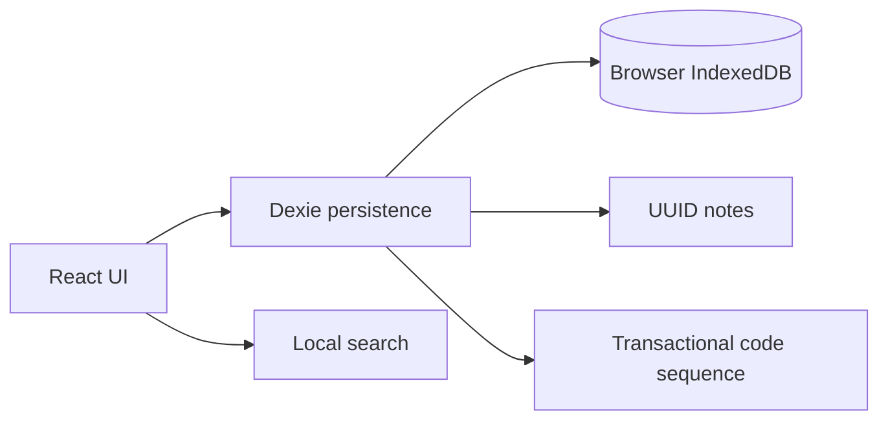

# Architecture

## Phase 1 runtime

The application is a Vite-served React single-page app written in TypeScript.
`src/App.tsx` owns view and interaction state. The visual system in
`src/styles.css` implements responsive layouts, dark/light/system palettes, lite
surfaces, and reduced motion. The app does not make network requests for notes.

`src/db.ts` is the persistence boundary. Dexie maps the `notes` and `sequences`
tables to IndexedDB. A note has a UUID primary key, a unique indexed `@` code,
title, content, and ISO creation/update timestamps. New-note creation reads the
sequence, checks the unique code index, inserts the note, and advances the
sequence in one read-write transaction. IndexedDB serializes overlapping
read-write transactions for the database, and the unique index enforces the
collision constraint at storage level. A stale sequence skips codes that are
already present.

`src/search.ts` provides deterministic, case-insensitive substring search across
all fields or by title/content, and exact matching for code, ID, title, or
content. Search is performed locally over notes already loaded from IndexedDB.

## Data flow

## Boundaries and future work

There is no server, user account, import/export, synchronization, encryption
layer, external AI, telemetry, or remote search in Phase 1. These are not implied
by the local-first foundation and require separate product and security decisions
before implementation.
